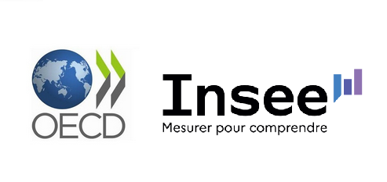
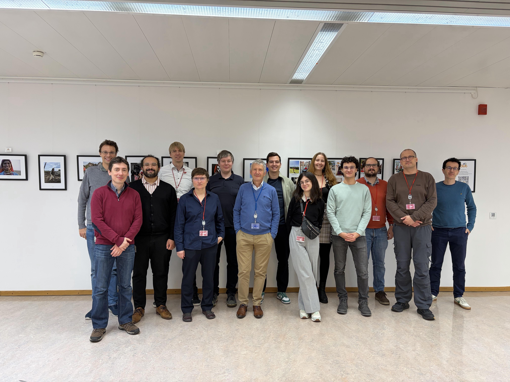
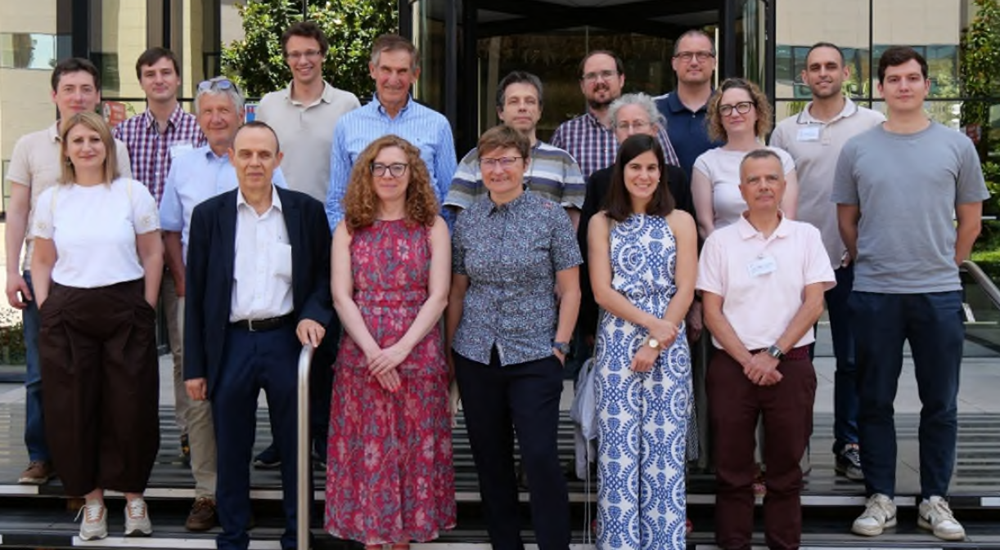

---
title: ""
---

# Events {.unnumbered}

Petit texte ?

## TSA Workshops

::: {.cosa-event-card .cosa-event-upcoming}

::: {.cosa-event-layout}

::: {.cosa-event-content}

::: {.cosa-event-label}
UPCOMING EVENT
:::

### OECD–Insee Workshop on Time Series Analysis

**For official statistics**

Paris, La Muette, France · **December 8–9, 2026**

Abstract submission closed on September 30, 2026.

[Discover the workshop→](https://www.oecd.org/en/events/2026/12/6th-workshop-on-time-series-analysis-for-official-statistics.html)

:::

{.cosa-event-logo}

:::

:::

## TSA Meetings

::: {.cosa-event-card}

::: {.cosa-event-label}
PAST EVENT · OCTOBER 2026
:::

### TSA Hands-on Meeting

**National Bank of Belgium · Brussels, Belgium**

A hands-on meeting to work collaboratively and discuss ongoing developments.

{.cosa-event-photo}

:::

::: {.cosa-event-card}

::: {.cosa-event-label}
PAST EVENT · JUNE 2026
:::

### TSA Reporting Meeting

**Madrid, Spain**

A project meeting to discuss ongoing activities.

{.cosa-event-photo}

:::

## SDC Meetings

## TSA Meetings

