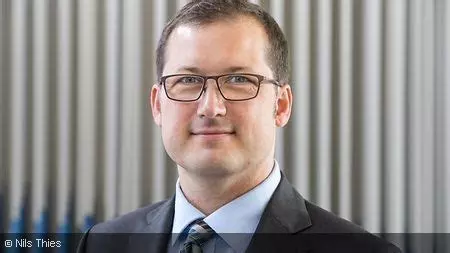
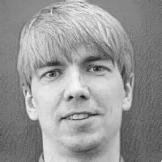

# Teams {.unnumbered}

COSA brings together experts from national statistical institutes across Europe, working together on statistical confidentiality and time series analysis.

<!-- ## Consortium coordination -->

<!-- Insee -->

<!-- ## SDC -->

<!-- CBS, Insee, Destatis, Statistik Austria, Statistic Iceland, Statistic Norway, Surs -->

<!-- ## TSA -->

<!-- Insee, NBB, INE, Istat, Destatis, CBS, Surs, HCSO and Bundesbank as an Associate Partner -->

## Consortium coordination

::: {.cosa-team-grid}

::: {.cosa-person-card}
{.cosa-person-photo}
**Anna Smyk**

Insee
:::

:::

## Statistical Disclosure Control (SDC)

::: {.cosa-team-institutions}
**Participating institutions:** CBS · Insee · Destatis · Statistik Austria · Statistic Iceland · Statistic Norway · SURS
:::

::: {.cosa-team-grid}

::: {.cosa-person-card}

PW

**Peter-Paul de Wolf**

CBS
:::

::: {.cosa-person-card}

LB

**Laurent Brochet**

Insee
:::

::: {.cosa-person-card}

NF

**Nadège Ferrer-Pradines**

Insee
:::

::: {.cosa-person-card}

JD

**Julien Desclodure**

Insee
:::

::: {.cosa-person-card}

DL

**Dimitri Lemaire**

Insee
:::

::: {.cosa-person-card}

AY

**Arnaud Yapou Nderkanzuku**

Insee
:::

:::

## Time Series Analysis (TSA)
::: {.cosa-team-institutions}
**Participating institutions:** Insee · NBB · INE · Istat · Destatis · CBS · SURS · HCSO · Deutsche Bundesbank (Associate Partner)
:::

::: {.cosa-team-grid}

::: {.cosa-person-card}
{.cosa-person-photo}
**Anna Smyk**

Insee
Coordinator
:::

::: {.cosa-person-card}

CL

**Corentin Lemasson**

NBB
:::

::: {.cosa-person-card}

CS

**Carlos Sáez Calvo**

INE
:::

::: {.cosa-person-card}

JR

**Juan Rodenas Gomez**

INE
:::

::: {.cosa-person-card}

AP

**Alessandro Piovani**

Istat
:::

::: {.cosa-person-card}

LV

**Lukas Vogel**

Destatis
:::

::: {.cosa-person-card}

PO

**Pim Ouwehand**

CBS
:::

::: {.cosa-person-card}
{.cosa-person-photo}
**Eulalie Delaune**

Insee
:::

::: {.cosa-person-card}

PC

**Philippe Charles**

NBB
:::

::: {.cosa-person-card}
{.cosa-person-photo}
**Karsten Webel**

Deutsche Bundesbank
:::

::: {.cosa-person-card}
{.cosa-person-photo}

**Daniel Ollech**

Deutsche Bundesbank
:::

::: {.cosa-person-card}

TW

**Thomas Witthohn**

Deutsche Bundesbank
:::

::: {.cosa-person-card}

JP

**Jean Palate**

Independant Researcher
:::

:::
