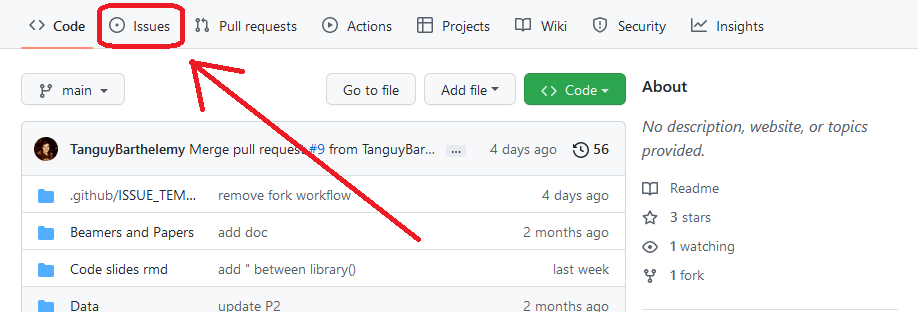
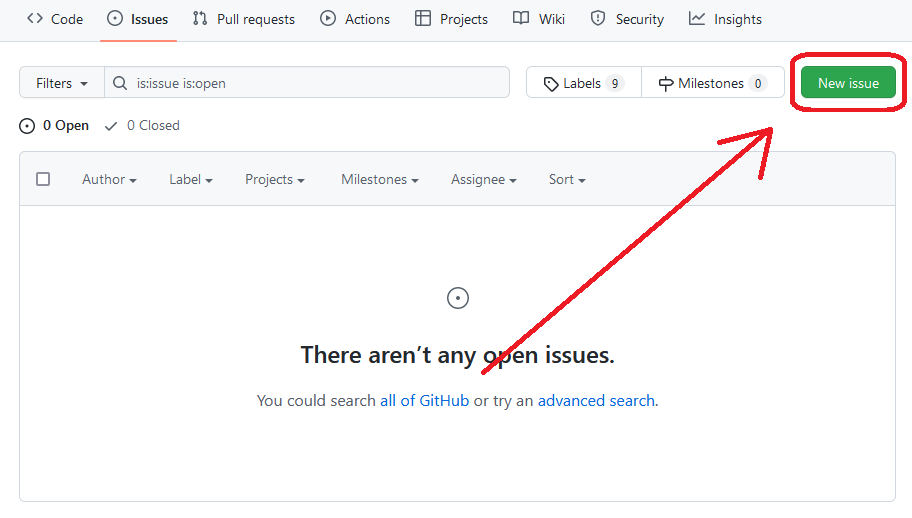
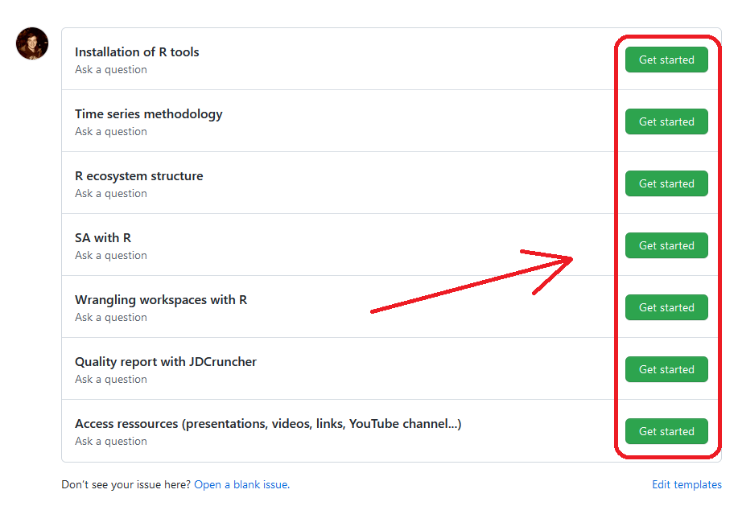
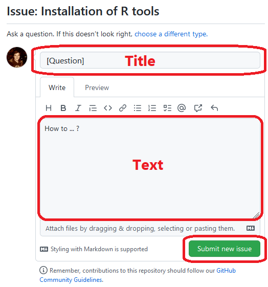

# User Support {.unnumbered}

::: {.cosa-event-card .cosa-event-upcoming}

### Links to the User Support pages

**GitHub**

### [SDC](https://github.com/sdcTools/UserSupport)

### [TSA](https://github.com/cosa-tsa-shop/UserSupport)

:::

## 🙋 How to ask a question?

To ask a question, you can complete an issue directly on GitHub. You need to have a GitHub account.
To complete an issue on GitHub, you should:

1.Go to the *Issues* tab:

2. Click on *New issue*:

3. Choose one of the themes proposed in the list and click on *Get started*:

4. Fill the question with a title and a text to explain the problem or the request and click on *Submit new issue*:

