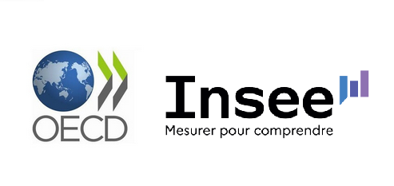

:::::: cosa-hero

{.cosa-logo-bloc}

::: cosa-grant-label
A EUROSTAT CO-FOUNDED PROJECT
:::

::: cosa-hero-title-row

# COSA

{.cosa-eurostat-logo}

:::

::: cosa-full-name
**CO**nfidentiality · **S**easonal **A**djustment and Time Series
:::

::: cosa-hero-intro
Developing tools for Seasonal Adjustment and Statistical Disclosure Control
:::

::::::

## Latest

::::: cosa-latest
:::: cosa-latest-content
::: cosa-latest-tag
UPCOMING EVENT
:::

### OECD–Insee Workshop on Time Series Analysis

**For official statistics**

Paris, La Muette, France · **December 8–9, 2026**

Abstract submission is open and will close on September 30, 2026.

[Discover the workshop→](https://www.oecd.org/en/events/2026/12/6th-workshop-on-time-series-analysis-for-official-statistics.html)
::::

{width="250px"}
:::::

## In a nutshell

COSA is a European Statistics Action Grant consisting of two centres of excellence:

::::: cosa-pillars
::: {.cosa-pillar .cosa-pillar-yellow}
### Statistical Disclosure Control

**SDC**

Supporting methods and tools for statistical confidentiality.
:::

::: {.cosa-pillar .cosa-pillar-orange}
### Time Series Analysis and Seasonal Adjustment

**TSA**

Developing expertise and tools for high-quality time series analysis and seasonal adjustment.
:::
:::::

### COSA is meant to

- Provide assistance and services to ESS and ESCB members in their activities regarding Time Series Analysis and Statistical Disclosure Control.
- Foster the development of a community of users, developers and statisticians.

The COSA consortium is composed of 12 different institutions and coordinated by the French National Statistical Institute, Insee.

::: cosa-portals
[**TSA portal**](https://jdemetra.org)

[**SDC portal**](https://sdctools.github.io/UserSupport/)
:::

## Roadmap

In a context of development of common tools and methods within the ESS, this action carries on the work of the STACE project (2020–2024) around three pillars: knowledge sharing and support to practitioners, development and maintenance of bespoke software (JDemetra+ for TSA, τ-ARGUS and sdcMicro for SDC) and methodological guidance (Handbooks, Guidelines, research papers).

The overarching goals is to provide user friendly, efficient and technically up-to-date tools for statistical production in both fields.

::: cosa-roadmap-block
### Time Series Analysis

In the previous project JDemetra+ has undergone a major refactoring with the development of version 3.x providing extensions of TSA algorithms, e.g. seasonal adjustment of high frequency data.

The current action will aim at consolidating and completing this new version, by further extending some algorithms, improving technical and user-documentation, uploading R packages on CRAN and adapting JDemetra+ to new IT environments, like cloud infrastructure.
:::

::: cosa-roadmap-block
### Statistical Disclosure Control

Τ-ARGUS is considered to be the standard software for table protection. However, τ-ARGUS urgently needs to be modernized.

The current project will make a start with developing/designing a modern software architecture for and apply some of the ideas in a proof of concept. The other SDC tools as well as the “old” τ-ARGUS needs to be supported.
:::

::: cosa-consortium
Eleven institutions (Insee, CBS, NBB, Istat, INE, Destatis, SURS, HSO, Statistic Austria, Iceland and Norway) are beneficiaries from this grant and will contribute in the aforementioned directions with the collaboration of the Deutsche Bundesbank in TSA.

Additional institutions will be involved as members of user-groups and observers (ECB, ABS, OECD…).
:::
